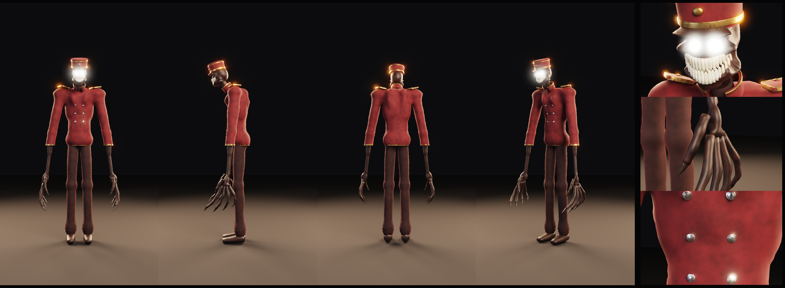
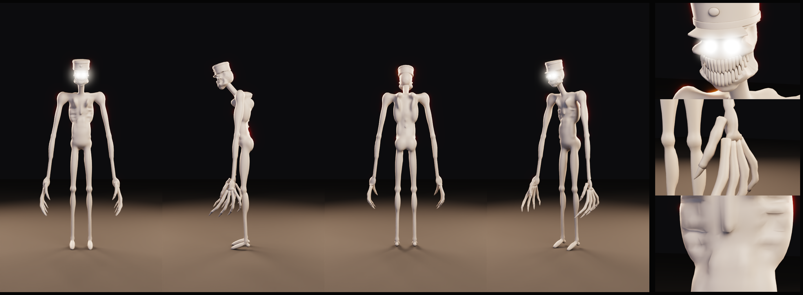
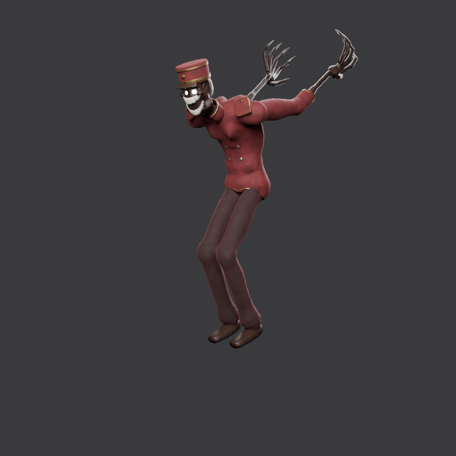

# Bellhop: жуткий коридорный

Стилизованный хоррор-персонаж для инди-игры (low/mid poly, преувеличенные пропорции).
Персонаж собирается процедурно одним скриптом `build_bellhop.py`. Результат проверен в Blender 5.3.

| Тест скелета: атакующая поза, пасть открыта, пальцы согнуты |
|---|
|  |

## Файлы
| Файл | Что это |
|---|---|
| `Bellhop.blend` | готовая сцена: 12 мешей и скелет |
| `exports/Bellhop.glb` | для Godot, Unity (glTFast) и веба |
| `exports/Bellhop.fbx` | для Unreal и Unity |
| `build_bellhop.py` | процедурная сборка: правишь константы, запускаешь и получаешь новую версию |

## Из чего состоит
| Объект | Треуг. | Материал | Что внутри |
|---|---|---|---|
| Bellhop_Head | 10 800 | Skin | SDF-череп: свод, затылок, челюсть, скулы, надбровье, глазницы, впалые виски и щёки, щель-улыбка с губами, морщины, складки у рта, шрам |
| Bellhop_Teeth | 2 368 | Teeth | 35 отдельных зубов по дуге рта, есть сломанный и кривой; нижний ряд привязан к кости `jaw` |
| Bellhop_Eyes | 448 | Eyes (emission) | светящиеся линзы на дне глазниц, левая глазница крупнее |
| Bellhop_Body | 4 178 | Skin | анатомия из метаболлов, ретопология QuadriFlow; кожа под одеждой удалена |
| Bellhop_Claws | 1 080 | Claws | отдельные загнутые когти |
| Bellhop_Jacket | 8 574 | RedFabric | пиджак с квадратными плечами и узкой талией, складки на локтях, швы, воротник с вырезом, эполеты с фаской |
| Bellhop_Shirt | 56 | DarkFabric | рубашка под воротником |
| Bellhop_Pants | 5 530 | DarkFabric | брюки клёш, заломы под коленом, гармошка у щиколотки, боковые швы |
| Bellhop_Shoes | 280 | Leather | большие плоские ботинки |
| Bellhop_Hat | 796 | RedFabric, Leather | тулья с фаской, изогнутый козырёк |
| Bellhop_Brass | 3 654 | OldBrass | канты подола, манжет и воротника, окантовка эполет, ленты шапки, кокарда, пуговицы эполет |
| Bellhop_Buttons | 1 008 | Metal | выточенные пуговицы с бортиком |
| **Итого** | **≈38 800** | 9 PBR | |

Скелет: 51 кость в именовании, близком к UE (`pelvis`, `spine_01…03`, `neck`, `head`, `jaw`,
`upperarm_l`, `index_01…03_l`…). Все кости используются, у всех вершин есть веса.

## Проверка (`blender/game_asset_checker.py`)
- **0 FAIL.** Трансформации применены, non-manifold рёбер нет, нормали согласованы, UV и материалы на месте.
- Оставшиеся WARN ожидаемы. Открытые края у одежды: у подола и манжет так и должно быть.
  Полюса находятся в треугольных заглушках зубов, пуговиц и пальцев. Один дубль вершины на стыке двух зубов.
- Пересечений нет: кожа не выходит из-под одежды, брюки не выходят из-под пиджака (проверено лучами по сетке).
- glTF: в экспорт уходят плоские PBR-значения. Процедурные ноды Blender не экспортируются,
  поэтому `export_for_engine.py` подставляет базовые цвета автоматически.

## Как открыть или пересобрать
- **Готовое:** открой `Bellhop.blend`.
- **Пересобрать:** Blender → Scripting → Open → `build_bellhop.py` → Run Script (≈40 с).
- **Через Claude Desktop (MCP):** «Прочитай `characters/Bellhop/build_bellhop.py` и выполни его в Blender».
- **Только анатомия:** поставь `SHOW_CLOTHES = False`.

Главные ручки в начале файла: `HEAD_TILT_DEG` (сутулость), `FINGER_LEN`, `MATERIALS` (цвета),
`EYE_EMISSION`, `BODY_FACES`/`JACKET_FACES`/`PANTS_FACES` (полигонаж), `HEAD_RES`.
Пропорции задаются в `define_skeleton()`, мышцы в `anatomy_balls()`, крой одежды в `clothes_balls()`.

## Чего ещё нет
- **Запечённые текстуры.** Фактура ткани, патина латуни и поры кожи сейчас процедурные и видны только в Blender.
  В движок уходят однотонные PBR-значения. Следующий шаг: запечь Normal, AO, BaseColor и Roughness
  (промпты 6–7 в `prompts/stage_prompts.md`).
- **Анимации.** Скелет готов, клипов нет.
- **Свечение глаз в движке.** Включи Bloom. На рендерах выше свечение добавлено постобработкой.
- **Финальный ручной проход.** Дальше качество поднимает только художник: скульпт лица и складок кистями,
  ручная ретопология лица, покраска текстур. Процедурная сборка даёт хорошую основу, но не заменяет ручную работу.
