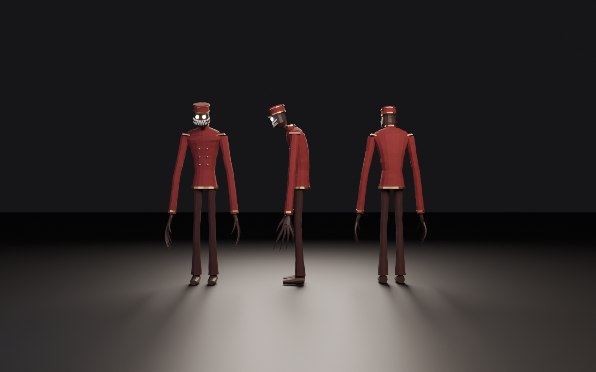
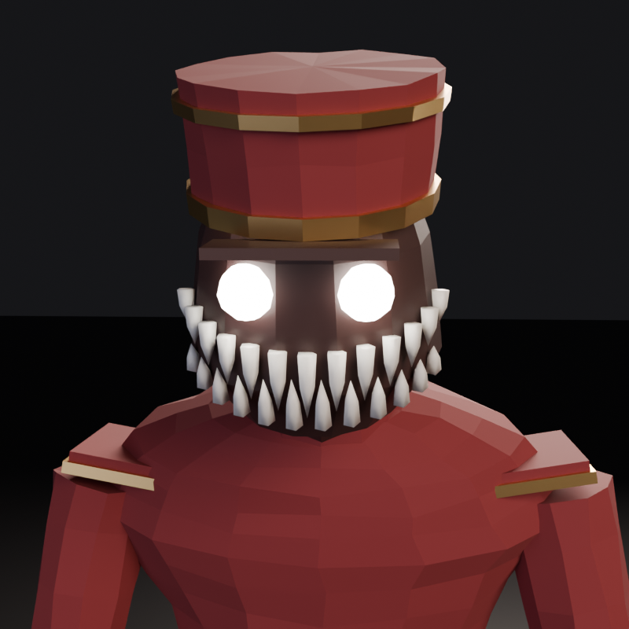
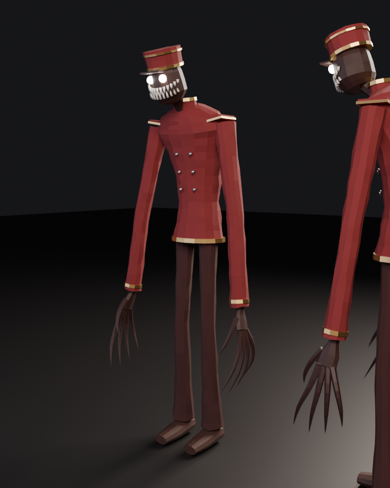
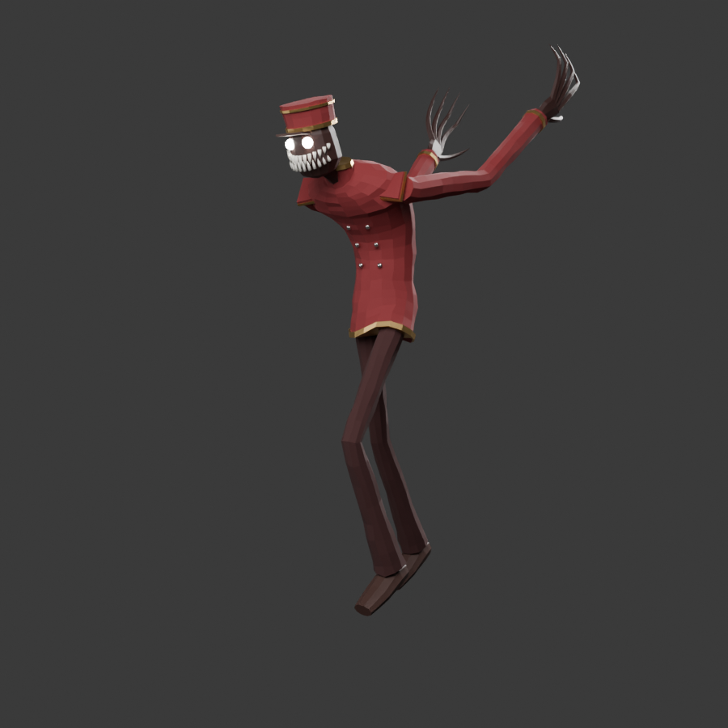

# Bellhop — жуткий коридорный

| Лицо | 3/4 | Тест скелета |
|---|---|---|
|  |  |  |

## Файлы
| Файл | Что это |
|---|---|
| `Bellhop.blend` | готовая сцена: меш + скелет, открыть в Blender |
| `exports/Bellhop.glb` | для Godot / Unity (glTFast) / веба |
| `exports/Bellhop.fbx` | для Unreal / Unity |
| `build_bellhop.py` | процедурная сборка: правишь константы, запускаешь и получаешь новую версию |

## Характеристики (проверено `blender/game_asset_checker.py`, Blender 5.3)
- Рост ≈ 2.45 м с шапкой, масштаб в метрах, трансформации применены
- 5 548 треугольников, low-poly с плоским затенением, как на референсе
- 8 материалов: Jacket, Gold, Pants, Skin, Teeth, Shoes, Button, Eyes (свечение)
- UV-развёртка (Smart UV Project)
- Скелет из 40 костей в именовании в стиле Unreal (`pelvis`, `spine_01…03`, `upperarm_l`, `index_01_l`…), по 2 кости на каждый коготь
- Все вершины имеют веса, подол пиджака следует за бёдрами
- Итог проверки: **0 FAIL**, 1 WARN (полюса в треугольных заглушках на концах трубок, для этого стиля это норма)

## Как открыть / пересобрать
- **Открыть готовое:** двойной клик по `Bellhop.blend`.
- **Пересобрать в своей сцене:** Blender → Scripting → Open → `build_bellhop.py` → Run Script.
- **Через Claude Desktop (MCP):** «Прочитай `characters/Bellhop/build_bellhop.py` и выполни его в Blender».

Что крутить в начале скрипта: `HEAD_TILT_DEG` (сутулость головы), `FINGER_LEN` (длина когтей),
`CLOTH_JITTER` (мятость ткани), `COLORS` (цвета), `EYE_EMISSION` (яркость глаз).
Пропорции тела задаются в `define_skeleton()` и `JACKET_RINGS`.

## Чего ещё нет (следующие этапы пайплайна)
- **Текстуры.** Сейчас материалы однотонные. Для вида как на референсе нужны запечённые AO и Normal
  (складки ткани), фактура бархата на пиджаке и потёртость золота. Промпты этапов 6–7 в `prompts/stage_prompts.md`.
- **Анимации.** Скелет готов, но клипов (idle, ходьба, атака) нет.
- **Глаза светятся только в Blender.** В движке включи Bloom и/или назначь emissive-материал на глаза.
- Скелет собственный, не Rigify. Для ретаргета анимаций Mixamo/UE5 Mannequin нужно сопоставить кости
  (имена уже близки к UE).
