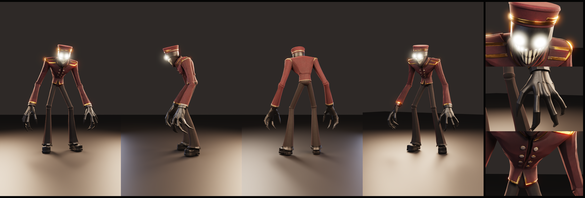

# Bellhop (Meshy): доработанные текстуры

Модель из Meshy уже пришла с UV и базовыми PBR-картами. Скрипт `enhance_meshy.py`
доводит их до уровня референса и игрового ассета.



## Что было и что стало
| Было (Meshy) | Стало |
|---|---|
| Глаза — просто белые пятна в цвете | Карта Emission, глаза светятся (strength 12, в движке включи Bloom) |
| Латунь не металл (Metallic ≈ 0) | Металлическая латунь: золото, патина в углублениях по AO, блеск |
| Кожа, кисти, брюки, обувь — один чёрный «пластик» | Разная шероховатость: кожа полуматовая, брюки матовые, обувь глянцевая |
| Ткань плоская | Бархат (маска Sheen), потёртости, плетение в normal map |
| Нет AO | AO-карта, умеренно вмешана в цвет |
| 563 тыс. треугольников | + игровая LOD-версия на 60 тыс. с теми же текстурами |

## Как это работает
1. Запекается **карта позиций**: для каждого текселя известна точка на теле. Затем запекается **AO**.
2. Каждый тексель классифицируется по цвету исходной текстуры и положению на теле:
   красная ткань, латунь, кожа (голова и кисти), брюки, кожа обуви, зубы, глаза.
   Разметка в `renders/regions.png`.
3. По маскам пересобираются карты BaseColor, Roughness, Metallic, Normal, Emission и Sheen.

## Файлы
| Файл | Что это |
|---|---|
| `textures/Bellhop_Meshy_*.png` | 2048² карты: BaseColor, Roughness, Metallic, Normal, Emission, Sheen, AO |
| `exports/Bellhop_Meshy_LOD.glb` | игровая версия, 60 тыс. треугольников, все карты внутри |
| `enhance_meshy.py` | скрипт; пересобирает всё из исходного GLB примерно за минуту |

Полная версия (563 тыс. треугольников) и `.blend` в репозиторий не кладутся из-за размера (31 и 50 МБ).
Их пересобирает скрипт:

```bash
blender --background --python enhance_meshy.py -- meshy-model.glb out_dir 60000
```

## Ограничения
- LOD сделан через Decimate без ретопологии. Для анимации лучше сделать ручную или QuadriFlow-ретопологию
  и запечь карты с полной версии.
- Скелета нет. Для анимации нужен риггинг (Rigify или Mixamo).
- Sheen (бархат) в glTF уходит расширением `KHR_materials_sheen`. Не все движки его читают,
  но базовые карты работают везде.
