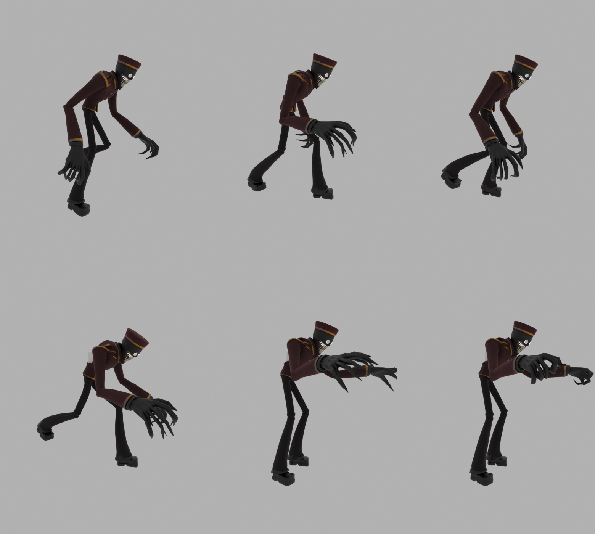
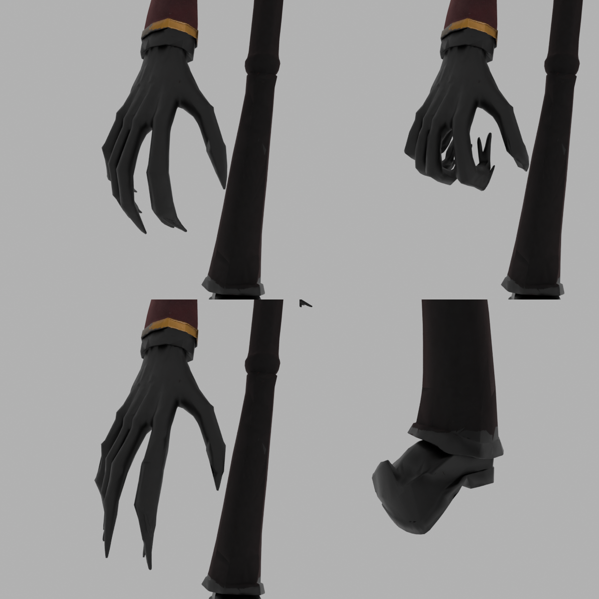

# Коридорный: подвижное живое тело (R15 + пальцы + носки)

Сверху: три фазы шага и бег. Снизу: тянется к игроку (когти раскрыты) и хватает (когти сжаты).

Пальцы: покой / сжаты / растопырены; носок ботинка гнётся при шаге.

## Что в модели
- Все суставы R15: Root, Waist, Neck, плечи, локти, запястья, бёдра, колени, голеностопы.
- **Пальцы**: каждый когтистый палец — цепочка из 3 костей (`LeftFinger1_1..3`, … всего 9 пальцев:
  4 на левой, 5 на правой — так сделана исходная сетка). Веса плавно переходят по длине пальца.
- **Носки**: `LeftToe`, `RightToe` — перекат стопы.
- Лицо не анимируется (кости челюсти/глаз/фуражки есть, но скрипт их не трогает).

## Как поставить
1. Studio → Import 3D → `Bellhop_R15_Body.fbx` (Rig Type: R15).
2. Загрузи 4 PNG из `textures/`, впиши ID в `SetupInStudio.lua`, выдели модель, выполни в Command Bar.
3. `BellhopBody.client.lua` → **LocalScript** в `StarterPlayer > StarterPlayerScripts`.
4. `BellhopNPC.server.lua` → Script **внутри модели** (водит коридорного к игроку).
5. Если стоял `BellhopFace.client.lua` из прошлой версии — удали его.

## Что делает `BellhopBody.client.lua`
| Состояние | Движения |
|---|---|
| Стоит | дышит, покачивается, руки висят с запаздыванием, пальцы шевелятся, иногда перебирают по очереди или дёргаются, корпус резко «хрустит» |
| Идёт | сутулая раскачивающаяся походка: подъём колена, перекат стопы и носка, качание таза, противоход длинных рук |
| Бежит (скорость > 11) | сильный наклон вперёд, руки тянутся вперёд, когти щёлкают |
| Игрок ближе 11 стадов | тянется обеими руками, сжимает-разжимает когти волной, голова следит за игроком |

Настройки в `CFG`: длина шага, радиусы, частота рывков, `AMOUNT` — общая сила движений.
Свои анимации: в Animation Editor видны все кости, включая фаланги пальцев; если используешь свои
анимации, отключи `BellhopBody.client.lua` (иначе он перебивает их каждый кадр).

## Если что-то не так
| Проблема | Решение |
|---|---|
| Тело не двигается | LocalScript должен быть в StarterPlayerScripts, а в модели — кости `LeftFinger1_1` и т.п. (импорт как R15) |
| Ноги «проваливаются» / висит над полом | Подправь `Humanoid.HipHeight` (≈3–3.5) |
| Слишком дёргано или вяло | `CFG.AMOUNT` = 0.6…1.4 |
| Ходит с обычной анимацией Roblox | Убери из модели скрипт `Animate`, если Studio его добавил |

Пересборка: `python ../roblox_body_rig.py -- Bellhop_R15_Face.blend out_dir pose`
(вход — результат `roblox_face_rig.py`, он нужен ради разреза рта и закрашенных глазниц).
