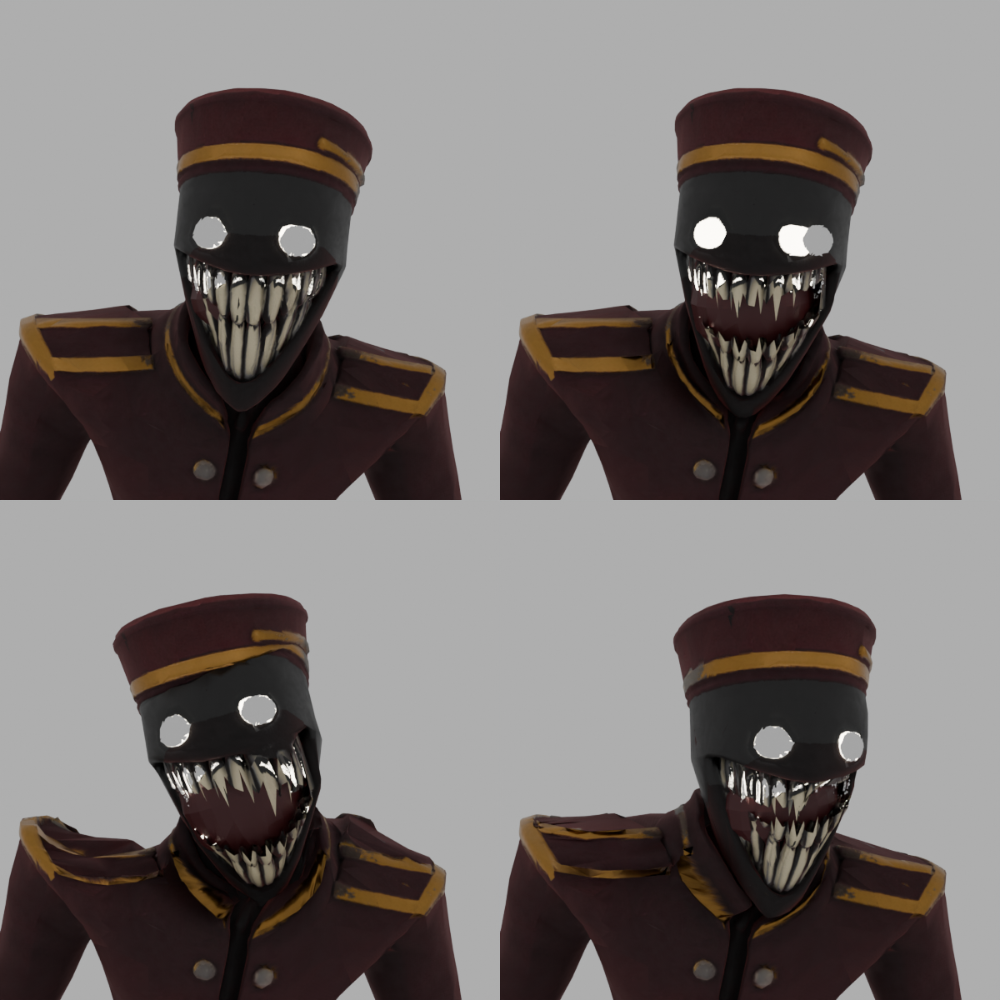

# Коридорный с живым лицом (R15 + лицевые кости)

Тот же персонаж R15, что в `../roblox_r15`, но с подвижным лицом. Слева направо, сверху вниз на картинке:
покой → рот приоткрыт и глаза смотрят в сторону → крик, наклон головы и подпрыгнувшая фуражка → поворот головы.

## Что добавлено
| Кость (Bone в части Head) | Что двигает |
|---|---|
| `Jaw` | нижняя челюсть: рот прорезан по линии смыкания зубов, ряды зубов расходятся, внутри тёмная полость и язык (меш `Mouth`) |
| `LeftEye`, `RightEye` | светящиеся глаза — взгляд, дрожание (под глазами на текстуре теперь чёрная маска, поэтому моргание видно) |
| `HatBone` | фуражка — покачивание, подпрыгивание |
| шея | стандартный сустав R15 `Neck` (поворот и наклон головы), корпус — `Waist` |

Все остальные суставы R15 как раньше: ходьба, стандартные анимации и Animation Editor работают.

## Как поставить
1. **Импорт.** Studio → Import 3D → `Bellhop_R15_Face.fbx` (Rig Type: R15, рост ~7 стадов).
2. **Текстуры.** Загрузи 4 PNG из `textures/` (Asset Manager → Bulk Import), впиши их ID в `SetupInStudio.lua`,
   выдели модель и выполни скрипт в Command Bar. Это ставит текстуры, делает глаза Neon, рот тёмным.
   Важно: `Bellhop_Color.png` здесь **новый** (глаза закрашены) — загрузи его заново.
3. **Живое лицо.** `BellhopFace.client.lua` → **LocalScript** в `StarterPlayer > StarterPlayerScripts`.
4. **Движение NPC** (по желанию). `BellhopNPC.server.lua` → Script внутри модели.
5. **Play.** Подойди к коридорному.

Что делает `BellhopFace.client.lua`:
- голова поворачивается за игроком, время от времени резко и жутко склоняется набок;
- глаза следят за игроком и моргают;
- челюсть «дышит», вблизи (14 стадов) щёлкает зубами, раз в 5–11 секунд распахивается в крик —
  глаза вспыхивают красным, голова дёргается к игроку, фуражка подпрыгивает;
- корпус дышит.
Настройки — таблица `CFG` в начале скрипта (радиусы, углы, частота крика, цвет глаз, звук `SCREAM_SOUND`).

## Свои анимации лица
Animation Editor → выбери модель → в списке костей появятся `Jaw`, `LeftEye`, `RightEye`, `HatBone` —
их можно ключевать как обычные суставы. Если используешь свои анимации лица, отключи соответствующие
части в `BellhopFace.client.lua` (иначе скрипт будет перебивать их каждый кадр).

## Если что-то не так
| Проблема | Решение |
|---|---|
| Рот не открывается, в Output нет ошибок | Проверь в Explorer, что внутри Head есть Bone `Jaw`. Если импорт превратил её в Motor6D — скрипт тоже это поддерживает |
| Рот открывается «внутрь» | Поменяй знак: в скрипте `r.jawSign` → умножь на -1 |
| Вокруг рта видно серое | Не выполнен `SetupInStudio.lua` — у части `Mouth` нет тёмного цвета |
| Глаза не моргают | Глаза должны быть Neon (шаг 2) |

Пересборка: `python ../roblox_face_rig.py -- Bellhop_R15.blend out_dir pose` (вход — результат `roblox_rig.py`).
