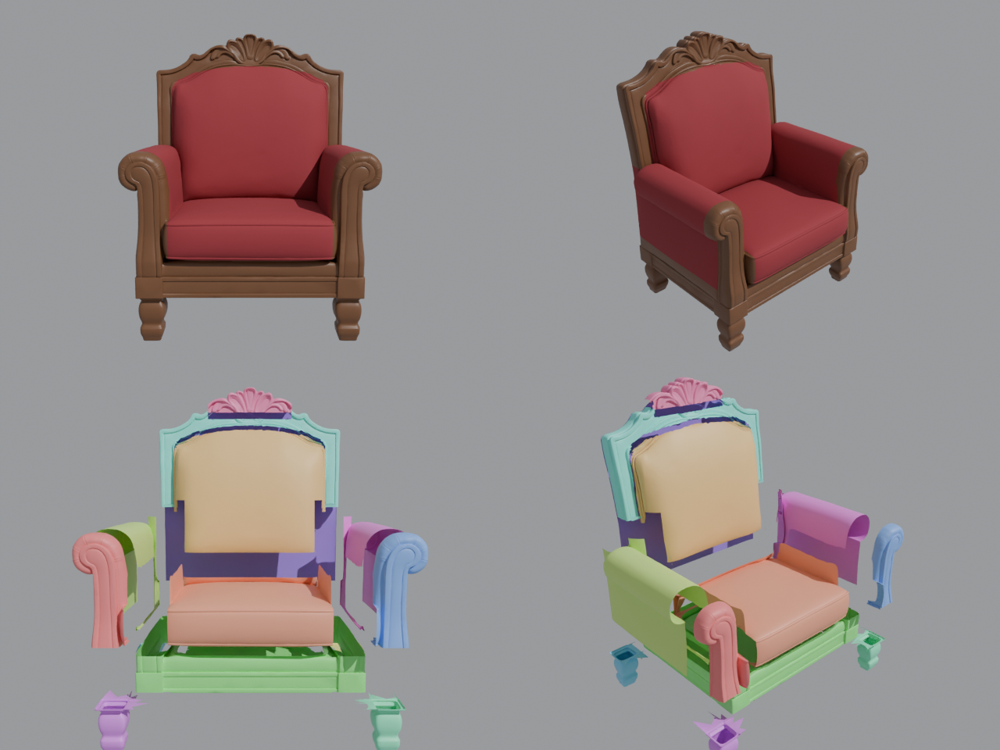

# Резное кресло — разделено на детали (для Roblox)

Исходник — `meshy-model_4.glb` (468 тыс. треугольников, без текстур). Форма и резьба сохранены,
полигонаж снижен до ~150 тыс. и разложен по 14 деталям, каждая < 20 000 треугольников (лимит MeshPart).
Высота 1.10 м, кресло стоит на полу, начало координат каждой детали — в её центре.

## Детали (`Armchair_Carved_Roblox.fbx`)
| Деталь | Что это | Материал |
|---|---|---|
| `Armchair_Leg_FL/FR/BL/BR` | точёные ножки | дерево |
| `Armchair_Base` | царга (рама под сиденьем) | дерево |
| `Armchair_Seat` | подушка сиденья | ткань |
| `Armchair_Arm_L/R` | мягкие подлокотники | ткань |
| `Armchair_ArmFront_L/R` | резные свитки спереди подлокотников | дерево |
| `Armchair_BackPanel` | мягкая вставка спинки | ткань |
| `Armchair_BackFrame` | резная рамка спинки | дерево |
| `Armchair_Crest` | резная корона сверху | дерево |
| `Armchair_BackRear` | задняя стенка | ткань |

## Как добавить
1. Roblox Studio → **Import 3D** → `Armchair_Carved_Roblox.fbx` (File Dimensions = **Meters**) → Import.
2. В модель кресла добавь **Script** и вставь `ArmchairSetup.server.lua`.
3. **Play** — кресло окрашено (дерево + бордовая ткань), закреплено, на него можно сесть.

Цвета меняются в начале скрипта (`WOOD_COLOR`, `FABRIC_COLOR`). Любую деталь можно перекрасить
или заменить отдельно — например, сделать подушку другого цвета или убрать корону.

Пересборка: `python split_armchair.py -- meshy-model_4.glb out_dir` (Blender как модуль `bpy`).
