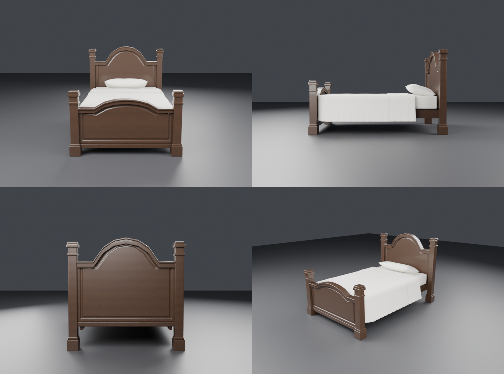
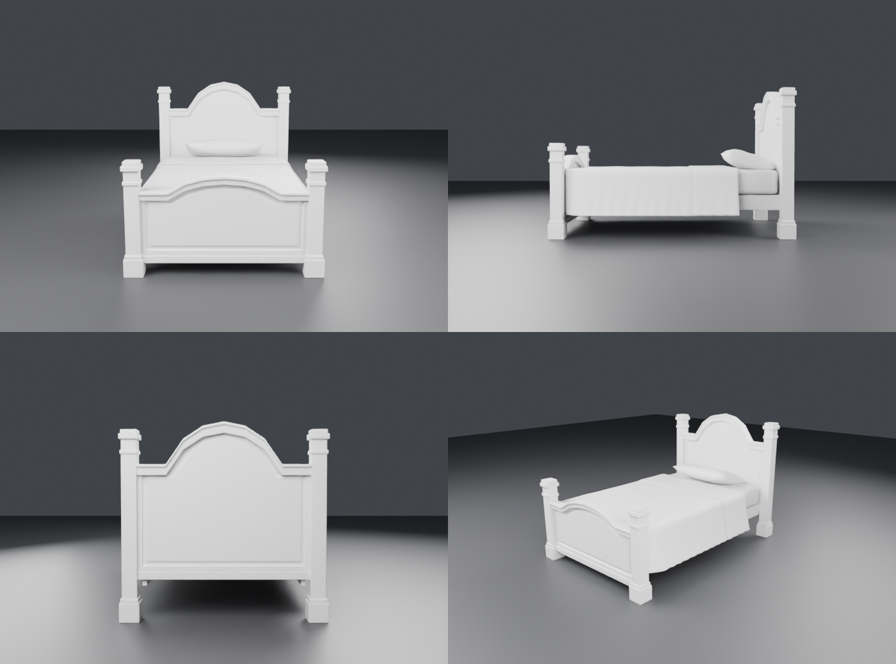

# Кровать с аркой

Процедурная модель по референсу: столбики с базой и капителью, изголовье и изножье с гранёной
аркой (плоские «плечи», грань вверх, пологий верх), рамками и филёнками, толстые верхние канты,
царги и реечное основание. Одеяло драпировано вокруг матраса: свисает по бокам с раструбом и складками,
у изголовья отворот. Подушка прислонена к изголовью.

| Объект | Треугольники | Материал |
|---|---|---|
| Bed_Frame | 7 564 | дерево (орех) |
| Bed_Mattress | 300 | ткань |
| Bed_Blanket | 18 232 | ткань |
| Bed_Pillow | 2 016 | ткань |

Пересечений между частями нет (проверено BVH). Каждая часть меньше лимита Roblox в 20 тыс. треугольников.
Размер: 1.45 × 2.2 м, изголовье 1.42 м.

## Файлы
- `exports/Bed_Roblox.fbx` — для Roblox (метры, Y вверх, −Z вперёд)
- `exports/Bed.glb` — для Unity, Godot и веба
- `Bed.blend` — сцена Blender
- `build_bed.py` — генератор: `blender --background --python build_bed.py -- out_dir [walnut|white]`
  (`white` — белая краска, как на референсе). Размеры, высоты арок, длина свеса одеяла и складки
  задаются константами в начале файла.

## В Roblox
1. **Import 3D** → `Bed_Roblox.fbx`. Если размер не тот, поставь **File Dimensions = Meters**:
   кровать получится примерно 5 × 8 стадов, в масштабе с персонажем-коридорным.
2. Появится модель из 4 MeshPart. Выдели все части → **Anchored = true**.
3. Материалы (Properties):
   - `Bed_Frame`: Material = **Wood**, Color = (75, 40, 22). Для белой версии — SmoothPlastic, (230, 228, 222);
   - `Bed_Blanket`, `Bed_Mattress`, `Bed_Pillow`: Material = **Fabric**, Color = (232, 226, 210).
4. Чтобы на кровать можно было лечь или сесть, добавь в Bed_Mattress **Seat** или ProximityPrompt.
   Для коллизий у одеяла поставь CollisionFidelity = Box: так дешевле для физики.
