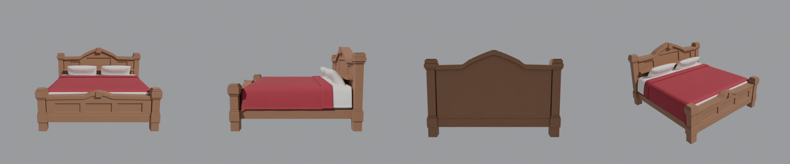

# Двуспальная кровать по деталям — для Roblox

Кровать построена заново «1 в 1» по модели Meshy (размеры сняты с неё): 2.2 × 2.2 м, высота 1.43 м.
Без текстур, 16 отдельных деталей:

| Деталь | Что это |
|---|---|
| `Bed_Post_HL/HR/FL/FR` | 4 столбика (H — изголовье, F — изножье) |
| `Bed_Headboard`, `Bed_Headboard_Cap` | щит изголовья с филёнками и полкой, арочный карниз |
| `Bed_Footboard`, `Bed_Footboard_Cap` | щит изножья с филёнками, арочный карниз |
| `Bed_Rail_L/R` | боковые царги |
| `Bed_Mattress`, `Bed_Sheet` | матрас, простыня |
| `Bed_Duvet`, `Bed_Duvet_Cuff` | одеяло и его отворот |
| `Bed_Pillow_L/R` | подушки |

Каждая деталь меньше 13 тыс. треугольников (лимит Roblox — 20 тыс.).

## Как добавить
1. **Import 3D** → `BedKing_Roblox.fbx` (File Dimensions = **Meters**) → Import.
2. Положи в модель **Script** с текстом `BedSetup.server.lua` — он поставит материалы
   (Wood / Fabric), цвета и закрепит детали. Или назначь материалы вручную.
3. Любую деталь можно убрать, перекрасить или заменить — они независимые.
