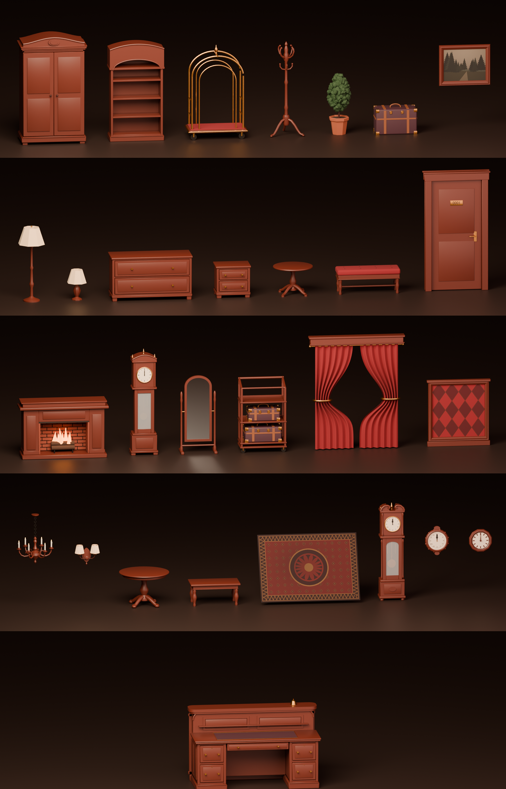

# Гостиничный набор мебели — 31 предмет для Roblox

Последний ряд — второй набор: люстра, бра, круглый стол, столик, ковёр, резные и настенные часы.

Все предметы с референса построены с нуля (`build_hotel_set.py`), каждый — отдельная модель из нескольких
деталей (MeshPart). Всего ~49 000 треугольников на весь набор — легко для Roblox.
Текстур нет (кроме холста картины и узора ковра) — материалы и цвета ставит скрипт.

| Предмет | Файл | Детали | Что умеет в игре |
|---|---|---|---|
| Шкаф | `Wardrobe.fbx` | корпус, 2 двери, ручки, штанга | двери открываются |
| Книжный шкаф | `Bookcase.fbx` | корпус | — |
| Тележка | `LuggageCart.fbx` | платформа, ковёр, латунная рама, колёса | — |
| Вешалка | `CoatRack.fbx` | цельная | — |
| Растение | `Plant.fbx` | горшок, земля, ствол, крона | — |
| Чемодан | `Suitcase.fbx` | корпус, ремни, латунные уголки | — |
| Картина | `Painting.fbx` | рама, холст (с текстурой) | — |
| Торшер | `FloorLamp.fbx` | стойка, абажур, латунь | светит |
| Настольная лампа | `TableLamp.fbx` | основание, абажур, латунь | светит |
| Комод | `Dresser.fbx` | корпус, 2 ящика, ручки | ящики выдвигаются |
| Тумбочка | `Nightstand.fbx` | корпус, 2 ящика, ручки | ящики выдвигаются |
| Журнальный столик | `CoffeeTable.fbx` | цельный | — |
| Банкетка | `Bench.fbx` | основание, мягкое сиденье, пуговицы | можно сесть |
| Дверь | `Door.fbx` | коробка, полотно, табличка «0001», ручки | открывается |
| Камин | `Fireplace.fbx` | портал, кирпичи, топка, решётка, дрова, огонь | горит, светит, мерцает |
| Напольные часы | `Clock.fbx` | корпус, стекло, циферблат, стрелки, маятник, гири | показывают время, маятник качается |
| Зеркало | `Mirror.fbx` | стойка, рама, зеркало, оси | отражает |
| Стеллаж для багажа | `LuggageRack.fbx` | рама, колёса, 2 чемодана | — |
| Шторы | `Curtains.fbx` | карниз, штанга, 2 полотна, подхваты | — |
| Панель на стену | `WallPanel.fbx` | рама, ромбы (2 цвета) | — |
| Люстра | `Chandelier.fbx` | корпус, цепь, 6 рожков, свечи, огоньки | светит |
| Ковёр | `Rug.fbx` | цельный (с текстурой узора) | — |
| Бра | `Sconce.fbx` | резная пластина-картуш (розетка, завитки, волюты, корона из листьев, подвеска), 2 S-образных рожка с латунными кольцами, чашечки и свечные трубки, плиссированные абажуры ([превью](renders/sconce.png)) | светит |
| Круглый стол | `RoundTable.fbx` | цельный (столешница, опора, 4 лапы) | — |
| Прямоугольный столик | `RectTable.fbx` | цельный (точёные ножки) | — |
| Резные часы | `GrandClock.fbx` | корпус с «лебединой шеей», стекло, циферблат с римскими цифрами, стрелки, маятник-лира, гири | показывают время, маятник качается |
| Настенные часы | `WallClock.fbx` | резной обод, циферблат с римскими цифрами, стрелки | показывают время |
| Стол-стойка ресепшена | `ReceptionDesk.fbx` | корпус (тумбы, столешница, стойка гостя с филёнками и подоконником), кожаная вставка, 5 ящиков с ручками, звонок портье из 3 деталей ([превью](renders/reception_desk.png)) | ящики выдвигаются, звонок нажимается |
| Люстра с абажурами | `GrandChandelier.fbx` | потолочная чаша, цепь, точёный 8-гранный корпус-ваза, 8 изогнутых рожков в два уровня, завитки, ступенчатые чашечки и патроны, 8-гранные абажуры-колокола с рёбрами, латунные пояски ([превью](renders/grand_chandelier.png)) | светит |
| Звонок портье | `DeskBell.fbx` | `Base` (подставка), `Dome` (купол), `Button` (кнопка со штоком) ([превью](renders/desk_bell.png)) | нажатие: кнопка уходит вниз и пружинит, купол дрожит, звук |
| Часы (12 граней) | `FacetClock.fbx` | 12-гранный обод, светлый циферблат, риски, стрелки ([превью](renders/facet_clock.png)) | показывают время |

## Как добавить в Roblox
1. Studio → **Import 3D** → нужный `.fbx` из папки `roblox/` (File Dimensions = **Meters**) → Import.
   Можно импортировать сразу несколько файлов; каждый предмет — отдельная модель.
2. Положи **один** Script с содержимым `HotelSetup.server.lua` в **ServerScriptService**.
3. **Play**. Скрипт найдёт все предметы набора в Workspace (и копии, добавленные позже), покрасит их,
   закрепит и включит: двери/ящики (подсказка **E**), часы, огонь, свет, сиденье.

Цвета и материалы — таблица `PALETTE` в начале скрипта. Угол дверей — `OPEN_ANGLE`.
Каждый предмет держи отдельной моделью (как после импорта) — так скрипт правильно находит его детали.

## Звонок портье
Нажатие — клавиша **E** или клик мышью. Чтобы был звук: Toolbox → Audio → найди «service bell» / «desk bell»,
скопируй ID и впиши в начало `HotelSetup.server.lua`: `local BELL_SOUND = "rbxassetid://ID"`.

## Только часы
Если нужны одни часы — положи `ClockScript.server.lua` **внутрь модели часов** (подходит для всех четырёх часов).
В начале скрипта `TIME_ZONE = 3` — часовой пояс (Москва). Не держи одновременно `HotelSetup` и `ClockScript` —
оба крутят стрелки. В `HotelSetup` часовой пояс тоже задаётся `TIME_ZONE`.

## Файлы
- `roblox/*.fbx` + `HotelSetup.server.lua` — для Roblox (то же в `HotelSet_Roblox.zip`)
- `models/*.glb` — те же модели в GLB, `HotelSet.blend` — всё вместе в Blender
- `textures/Painting_Canvas.png`, `textures/Rug_Pattern.png` — холст картины и узор ковра (зашиты в FBX)
- Пересборка: `python build_hotel_set.py -- out_dir render`
