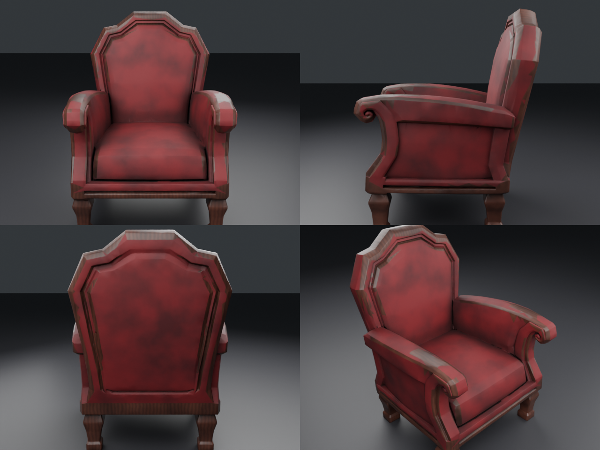
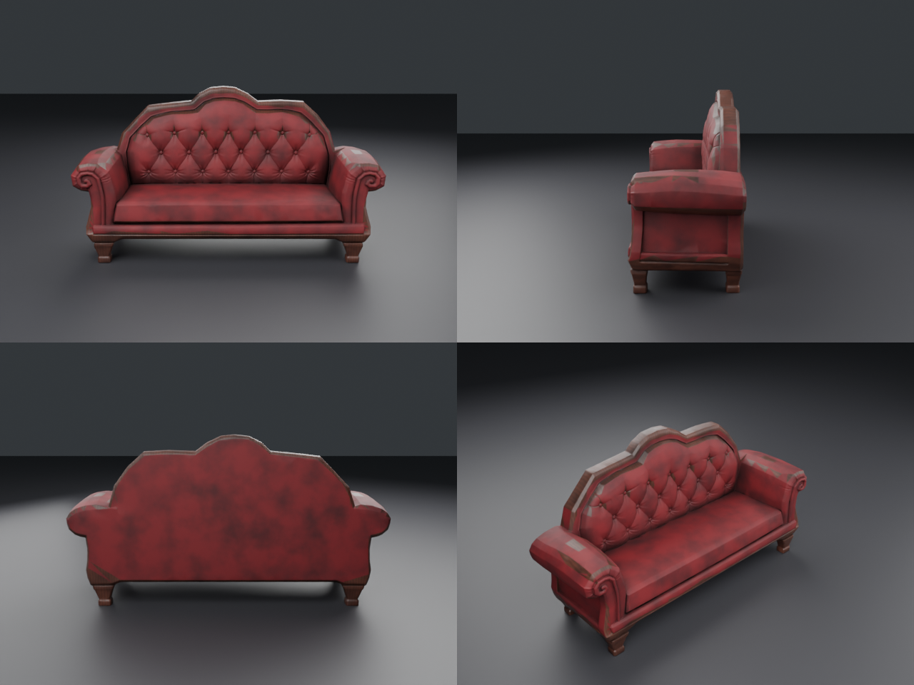
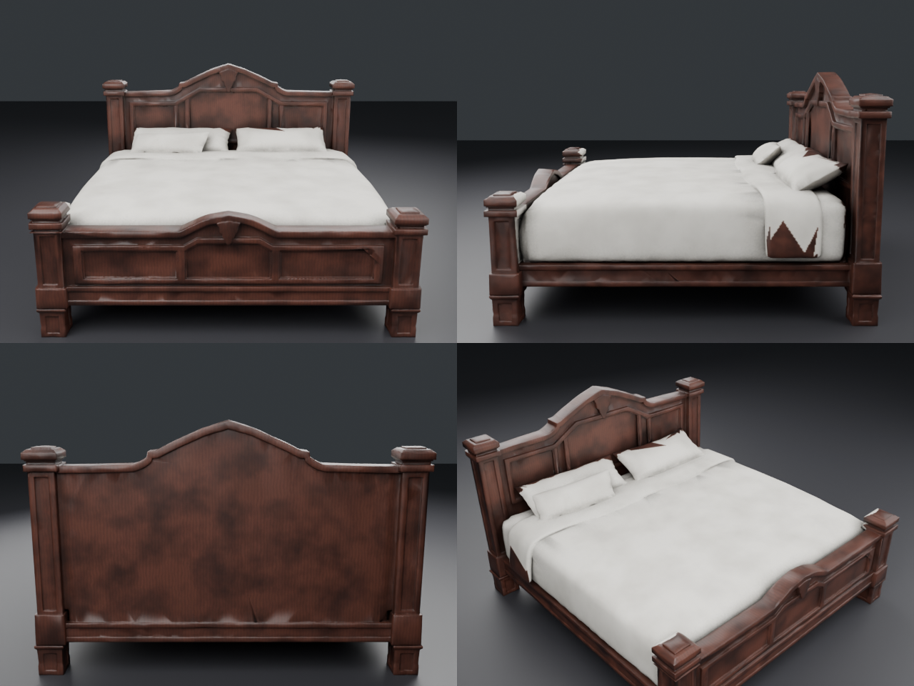

# Мебель из Meshy: кресло, диван, кровать с текстурами

| Кресло | Диван | Кровать |
|---|---|---|
|  |  |  |

Исходные GLB из Meshy были без UV и без текстур (только геометрия, 300–550 тыс. треугольников).
Скрипт `texture_furniture.py` сделал для каждой модели:
1. Масштаб в реальные метры: кресло высотой 1.1 м, диван длиной 2.1 м, кровать длиной 2.2 м.
2. Игровую сетку на 19 тыс. треугольников (лимит Roblox на MeshPart — 20 тыс.) с UV-развёрткой.
3. Разметку «дерево / ткань» по форме:
   - кресло и диван: ножки, царга, рамки по краю силуэта — дерево, остальное — красный бархат;
   - кровать: каркас — дерево, постель — светлый лён.
4. Запекание карт 1024²: Color (с AO), Roughness, Normal (мелкие детали — стяжка, складки — с полной модели), Metalness.

## Файлы (в каждой папке)
- `<Имя>_Roblox.zip` — всё для Roblox: FBX и 4 карты
- `<Имя>.glb` — для Unity, Godot и веба, текстуры внутри
- `textures/` — карты по отдельности (плюс AO)

## В Roblox
1. **Import 3D** → `<Имя>_Roblox.fbx` (File Dimensions = Meters), Anchored = true.
2. Загрузи 4 PNG через Asset Manager.
3. В MeshPart добавь **SurfaceAppearance** и задай карты: ColorMap = `_Color`, NormalMap = `_Normal`,
   RoughnessMap = `_Roughness`, MetalnessMap = `_Metalness`.

## Повторить на других моделях
```
blender --background --python texture_furniture.py -- model.glb out_dir chair|sofa|bed [1024]
```
Для UV лучше поставить `xatlas` в Python Blender (`pip install xatlas`), иначе используется Smart UV.

## Ограничения
- Разметка автоматическая, поэтому на сложных стыках бывают мелкие неточности. Например, на кровати
  у изголовья маленький уголок одеяла окрашен в дерево.
- Потёртости ткани и дерева запечены в Color, в Roblox они видны.
