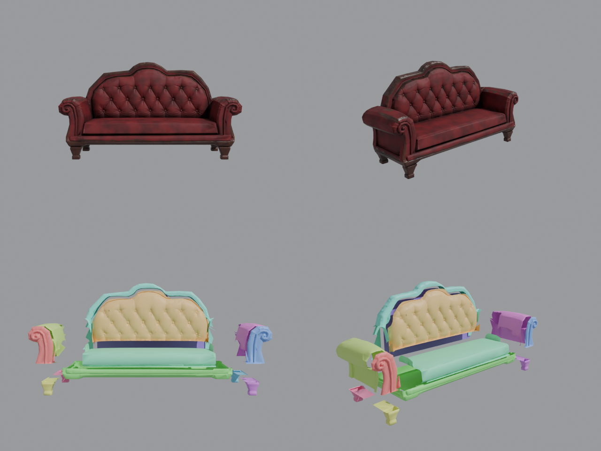
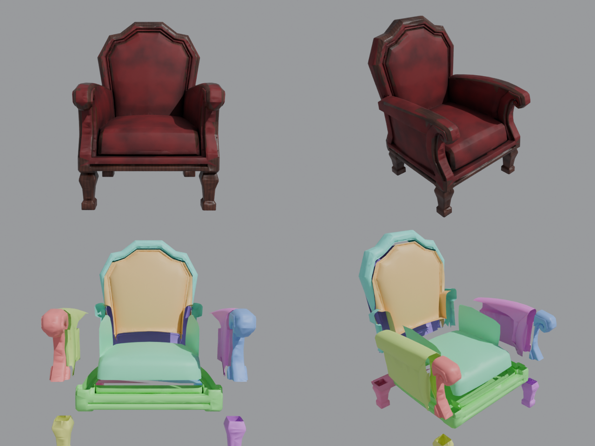

# Диван и кресло с текстурами — разделены на детали

| Диван | Кресло |
|---|---|
|  |  |

Это те же детализированные модели с текстурами, что и `props/MeshyFurniture/{Sofa,Armchair}`,
но разрезанные на отдельные детали: ножки (4), царга, сиденье, подлокотники, накладки подлокотников,
рамка спинки, мягкая панель спинки, задняя стенка. Все детали используют одну общую текстуру.

## Как добавить в Roblox
1. Studio → **Import 3D** → `Sofa/Sofa_Parts_Roblox.fbx` или `Armchair/Armchair_Parts_Roblox.fbx`
   (File Dimensions = **Meters**). Текстуры зашиты в FBX — детали сразу будут с текстурой.
2. В модель добавь **Script** и вставь `TexturedSeatSetup.server.lua` (закрепление + места для сидения).

Если текстура не подтянулась: на любую деталь добавь **SurfaceAppearance**, загрузи в него
`textures/*_Color.png` (ColorMap), `*_Normal.png` (NormalMap), `*_Roughness.png` (RoughnessMap) —
скрипт скопирует его на остальные детали.

Пересборка: `python ../split_meshy_parts.py -- ../../MeshyFurniture/Sofa/Sofa.glb out sofa`
