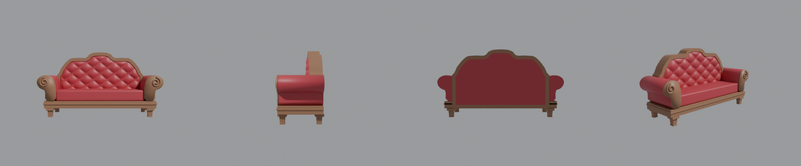
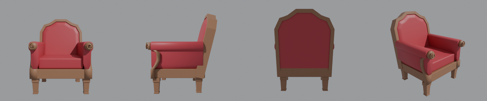

# Диван и кресло по деталям — для Roblox

| Диван | Кресло |
|---|---|
|  |  |

Построены заново «1 в 1» по моделям Meshy (размеры сняты с них). Без текстур, по деталям:

| Деталь | Диван (`Sofa_…`) | Кресло (`Armchair_…`) |
|---|---|---|
| Ножки | `Leg_FL/FR/BL/BR` | `Leg_FL/FR/BL/BR` |
| Царга | `Base` | `Base` |
| Подушка сиденья | `Seat` | `Seat` |
| Подлокотники | `Arm_L/R` | `Arm_L/R` |
| Дерево спереди подлокотника с завитком | `ArmFront_L/R` (накладка) | `ArmFront_L/R` (S-стойка) |
| Рамка спинки | `BackFrame` | `BackFrame` |
| Мягкая панель спинки | `BackPanel` (стяжка) | `BackPanel` |
| Задняя панель | `BackRear` | `BackRear` |
| Пуговицы | `Buttons` | — |

Размеры: диван 2.1 × 0.64 м, высота 1.13 м; кресло 0.82 × 0.89 м, высота 1.1 м.
Самая тяжёлая деталь — стяжка дивана (~8.6 тыс. треугольников), лимит Roblox 20 тыс.

## Как добавить
1. **Import 3D** → `Sofa_Roblox.fbx` или `Armchair_Roblox.fbx` (File Dimensions = **Meters**).
2. Положи в модель **Script** с текстом `SeatSetup.server.lua`: он поставит материалы (Wood/Fabric),
   цвета, закрепит детали и добавит места для сидения (диван — 3, кресло — 1).
3. Цвета меняются в таблице `COLORS` в начале скрипта.
