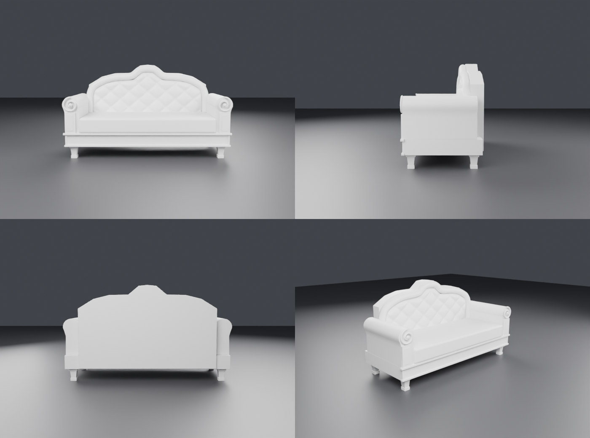

# Диван «капитоне» с горбатой спинкой

Процедурная модель по референсу:
- **Спинка:** силуэт с горбом в центре, «плечами» и скатом к подлокотникам. По контуру толстый валик-рамка,
  внутри стяжка «капитоне»: ромбы, складки по диагоналям, латунные пуговицы в узлах. Сзади гладкая.
- **Подлокотники-валики:** на торце завиток-волюта, ниже пилястра с филёнкой.
- **Низ:** пухлая подушка сиденья, царга с филёнкой и карнизом, сужающиеся ножки с башмачком.

| Объект | Треугольники | Материал |
|---|---|---|
| Sofa_Frame | ~15 800 | дерево (рамка спинки, волюты, царга, ножки) |
| Sofa_Upholstery | 832 | бархат (корпус спинки, подлокотники) |
| Sofa_Tufting | ~9 500 | бархат (стяжка) |
| Sofa_Cushion | 1 196 | бархат |
| Sofa_Buttons | 2 100 | латунь |

Каждая часть меньше лимита Roblox в 20 тыс. треугольников. Размер: 2.0 × 0.86 м, спинка 1.13 м, сиденье 0.49 м.
Части немного заходят друг в друга (пуговицы утоплены в стяжку, обивка — в каркас), чтобы на стыках не было щелей.

## Файлы
- `exports/Sofa_Roblox.fbx` — для Roblox (метры, Y вверх, −Z вперёд)
- `exports/Sofa.glb` — для Unity, Godot и веба
- `Sofa.blend` — сцена Blender
- `build_sofa.py` — генератор: `blender --background --python build_sofa.py -- out_dir [velvet|white]`.
  Силуэт спинки (`BACK_TOP`), размер ромбов стяжки (`TUFT_A`, `TUFT_B`) и размеры задаются в начале файла.

## В Roblox
1. **Import 3D** → `Sofa_Roblox.fbx` (File Dimensions = Meters). Выдели части → **Anchored = true**.
2. Материалы:
   - `Sofa_Upholstery`, `Sofa_Tufting`, `Sofa_Cushion`: **Fabric**, Color (110, 18, 28) — бордовый бархат;
   - `Sofa_Frame`: **Wood**, (75, 40, 22);
   - `Sofa_Buttons`: **Metal** или Foil, (200, 150, 70).
3. Чтобы на диван можно было сесть, добавь **Seat** на уровне подушки. Для физики поставь
   CollisionFidelity = Box у стяжки и пуговиц.
