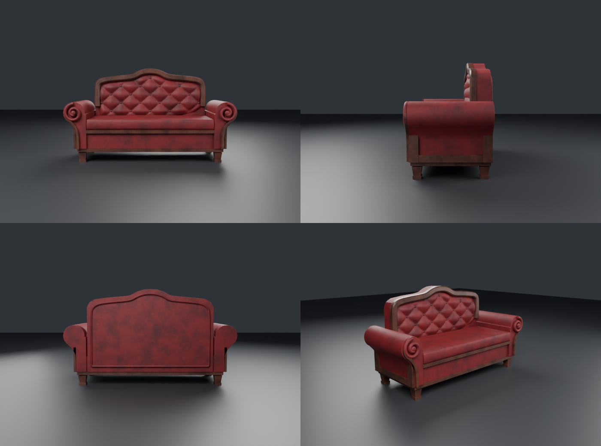
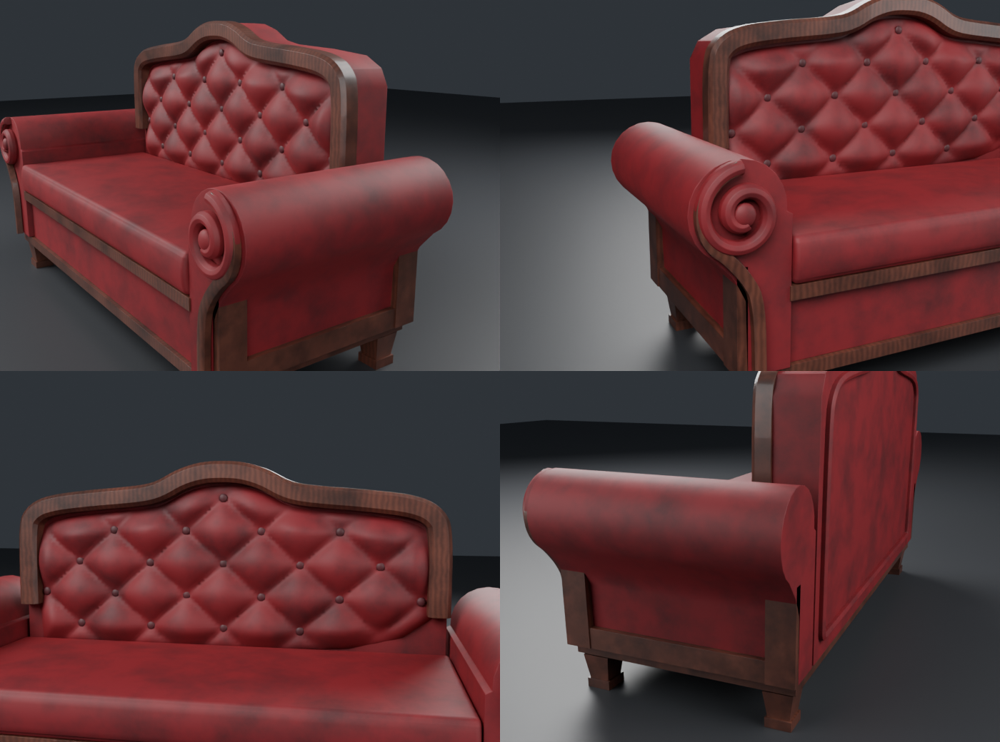

# Диван «капитоне» со свитковыми подлокотниками

Процедурная модель по референсу (версия 2):
- **Спинка:** силуэт с горбом в центре и пологими «плечами». Плоская профильная деревянная рама с фаской.
  Внутри крупная пышная стяжка «капитоне» с пуговицами, обтянутыми тканью. Сзади спинка обита тканью с бортиком по контуру.
- **Подлокотники-свитки:** боковина узкая внизу, валик нависает наружу. На торце тканевая спираль с пуговицей,
  по наружному краю деревянный кант. На боковинах деревянная рамка: стойки спереди и сзади, верхняя и нижняя планки.
- **Низ:** толстая подушка сиденья с пухлым передним краем, деревянная планка под ней, тканевый фартук,
  нижняя тяга, сужающиеся ножки с башмачком.
- **Материалы:** потёртый красный бархат (тёмные пятна, отлив в цвет ткани) и тёмное дерево с красноватым оттенком.

| Объект | Треугольники | Материал |
|---|---|---|
| Sofa_Frame | 10 460 | дерево |
| Sofa_Upholstery | 15 128 | бархат (спинка, подлокотники, спирали, фартук) |
| Sofa_Tufting | 9 212 | бархат (стяжка) |
| Sofa_Cushion | 1 448 | бархат |
| Sofa_Buttons | 2 000 | тёмный бархат |

Каждая часть меньше лимита Roblox в 20 тыс. треугольников. Размер: 2.1 × 0.8 м, высота 1.17 м, сиденье 0.53 м.

## Файлы
- `exports/Sofa_Roblox.fbx` — для Roblox (метры, Y вверх, −Z вперёд)
- `exports/Sofa.glb` — для Unity, Godot и веба
- `Sofa.blend` — сцена Blender
- `build_sofa.py` — генератор: `blender --background --python build_sofa.py -- out_dir [velvet|white]`.
  Силуэт спинки (`BACK_TOP`), валик подлокотника (`ROLL_C`, `ROLL_R`), ромбы стяжки (`TUFT_A`, `TUFT_B`) — в начале файла.

## В Roblox
1. **Import 3D** → `Sofa_Roblox.fbx` (File Dimensions = Meters). Выдели части → **Anchored = true**.
2. Материалы:
   - `Sofa_Upholstery`, `Sofa_Tufting`, `Sofa_Cushion`: **Fabric**, Color (140, 18, 24);
   - `Sofa_Buttons`: **Fabric**, (60, 8, 12);
   - `Sofa_Frame`: **Wood**, (80, 34, 22).
3. Чтобы на диван можно было сесть, добавь **Seat** на уровне подушки. Для физики поставь CollisionFidelity = Box у стяжки и пуговиц.
