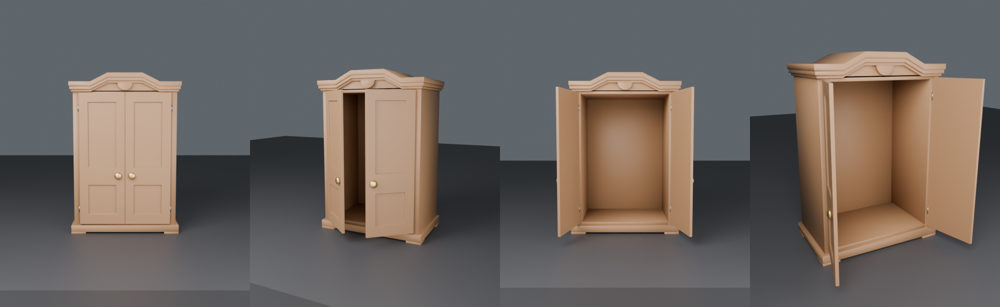

# Шкаф для Roblox — открывающиеся двери, без текстур

Шкаф построен с нуля «1 в 1» по модели из Meshy (размеры сняты с неё), высота 2 м (~7 стадов).
Текстур нет — материалы и цвета ставит скрипт (Wood / Metal), всё лёгкое: ~4 000 треугольников на весь шкаф.

## Что в архиве
- `Wardrobe_Roblox.fbx` — 6 деталей: `Wardrobe_Body` (корпус, пустой внутри), `Wardrobe_Door_L/R`,
  `Wardrobe_Knob_L/R` (ручки), `Wardrobe_Hinges` (петли)
- `WardrobeDoors.server.lua` — скрипт дверей

## Как добавить
1. Roblox Studio → **Import 3D** → `Wardrobe_Roblox.fbx` (File Dimensions = **Meters**) → Import.
2. В модель шкафа (Workspace) добавь **Script** и вставь в него `WardrobeDoors.server.lua`.
3. **Play** → подойди к шкафу → на каждой двери подсказка **E — Открыть** / **Закрыть**.

Скрипт сам: красит детали (дерево, латунь, металл), закрепляет корпус, прикрепляет ручки к дверям,
находит ось петли и поворачивает двери наружу на 100°.

Настройки в начале скрипта: `OPEN_ANGLE` (угол), `TIME` (скорость), цвета.

## Если что-то не так
| Проблема | Решение |
|---|---|
| Шкаф крошечный/огромный | При импорте File Dimensions = Meters (или Scale) |
| Ошибка «Не найдена деталь» | Скрипт должен лежать внутри модели шкафа |
| Дверь открывается не вокруг петли | Не поворачивай отдельные детали — поворачивай всю модель (Pivot) |
| Хочу другой цвет | Поменяй `WOOD_COLOR` в скрипте |
